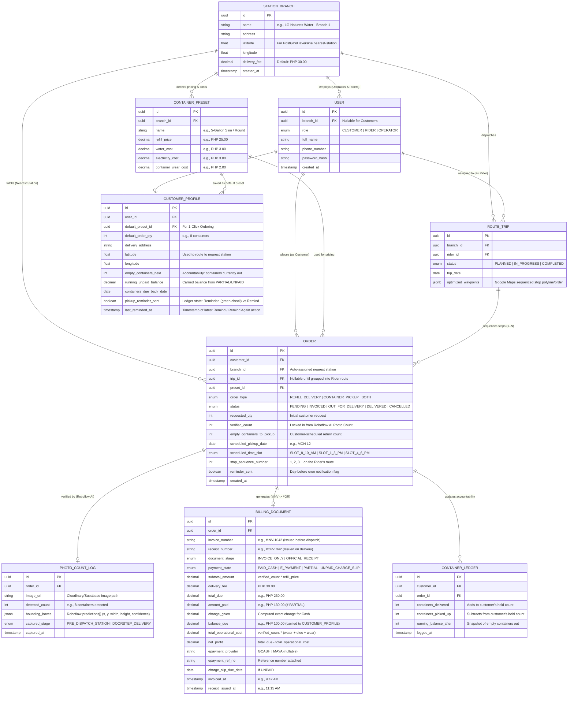

# Database Schema & Entity-Relationship Diagram (ERD)

## Overview
This Entity-Relationship Diagram (ERD) is designed for **PostgreSQL + Prisma ORM** and powers all 7 core features of the **LG Nature's Water** application:
1. **Nearest-Station & Sequenced Routing** (`STATION_BRANCH`, `CUSTOMER_PROFILE`, `ROUTE_TRIP`, `ORDER`)
2. **One-Click Ordering** (`CUSTOMER_PROFILE` + `CONTAINER_PRESET`)
3. **Scheduling & Container Pickup** (`ORDER.scheduled_time_slot` + `CONTAINER_LEDGER`)
4. **POS & True Profit Tracking** (`CONTAINER_PRESET` operational costs + `BILLING_DOCUMENT.net_profit`)
5. **AI Photo Container Count** (`PHOTO_COUNT_LOG` storing Roboflow `gallon-quality-detection` bounding boxes)
6. **Automatic Invoicing vs. Official Receipt** (`BILLING_DOCUMENT` transitioning from `#INV` to `#OR`)
7. **Proof of Delivery & 4-State Smart Receipts** (`BILLING_DOCUMENT.payment_state`: `PAID_CASH`, `E_PAYMENT`, `PARTIAL`, `UNPAID_CHARGE_SLIP`)

---

## Visual Entity-Relationship Diagram (Mermaid)

---

## Table Breakdown & Feature Mapping

| Table | Primary Responsibility |
| :--- | :--- |
| **`STATION_BRANCH`** | Stores branch coordinates (`latitude`, `longitude`) for nearest-station auto-selection and default delivery fees. |
| **`CONTAINER_PRESET`** | Stores preset container refill prices (`PHP 25.00`) alongside per-unit operational costs (`water_cost`, `electricity_cost`, `container_wear_cost`) so the POS calculates **True Net Profit** automatically. |
| **`USER`** | Unified authentication table supporting `CUSTOMER`, `RIDER`, and `OPERATOR` roles. |
| **`CUSTOMER_PROFILE`** | Stores customer GPS coordinates, saved 1-click reorder preferences (`default_preset_id`, `default_order_qty`), `empty_containers_held`, `running_unpaid_balance`, and Jug & Balance Ledger reminder state (`pickup_reminder_sent`, `last_reminded_at`) for the `Remind` → `Reminded` (green check) and `Remind Again` (`⋯` menu) workflow. |
| **`ROUTE_TRIP`** | Groups deliveries and scheduled container pickups on the same street into a single sequenced trip for a Rider. |
| **`ORDER`** | Tracks the lifecycle from customer tap (`PENDING`) to pre-dispatch photo invoice (`INVOICED`), dispatch (`OUT_FOR_DELIVERY`), and doorstep completion (`DELIVERED`), including pickup time slots (`8–10 AM`, `1–3 PM`, `4–6 PM`). |
| **`PHOTO_COUNT_LOG`** | Saves the captured container load photo URL, the total count detected by the **Roboflow Gallon Detection model**, and the `bounding_boxes` JSON array (`x, y, width, height`) to render numbered boxes (`1..8`). |
| **`BILLING_DOCUMENT`** | Implements **"One Count, Two Documents"**: starts as `#INV-XXXX` before dispatch and converts into `#OR-XXXX` on delivery, adapting to `PAID_CASH`, `E_PAYMENT`, `PARTIAL`, or `UNPAID_CHARGE_SLIP`. |
| **`CONTAINER_LEDGER`** | Immutable audit log tracking every container dropped off and picked up per customer. |
