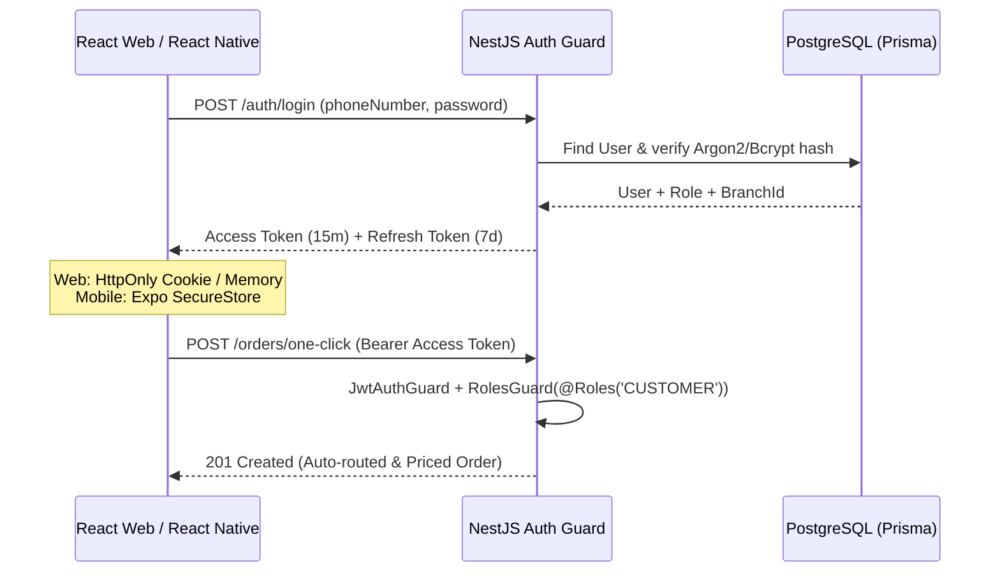

# Authentication, Registration & Security Plan

## Overview
The **LG Nature's Water** platform serves three distinct user roles across two client applications:
1. **Customers** (`CUSTOMER`) — Mobile App (React Native)
2. **Delivery Teams / Riders** (`RIDER`) — Mobile App (React Native)
3. **Water Refilling Operators** (`OPERATOR`) — Station Counter Web POS (React)

Because the platform handles **financial POS ledgers**, **unpaid credit balances (Charge Slips)**, and **home/office GPS coordinates**, the authentication system combines frictionless onboarding for customers (enabling **1-Click Ordering**) with strict Role-Based Access Control (RBAC) and branch isolation for staff.

---

## 1. Authentication Flows by Role

### A. Customer Registration & Onboarding ("Set Up Once, 1-Tap Forever")
To make **Feature 03 (One-Click Ordering)** work immediately after signup, Customer registration captures their delivery profile and default refill preset in a single 2-step onboarding flow:
1. **Step 1 — Account & Phone Verification:**
   * Inputs: `Full Name`, `Phone Number` (Philippines `+63` format, primary login identifier), and `Password` (or 6-digit PIN / OTP).
2. **Step 2 — 1-Click Delivery & Preset Setup:**
   * **Pin Location on Map (`expo-location`):** Captures `latitude`, `longitude`, and `delivery_address` (automatically calculates and links the **nearest LG Nature's Water branch**).
   * **Default Container Preset:** Selects usual container type (e.g., *5-Gallon Slim / Round*) and usual order quantity (e.g., *8 containers*).
   * Result: Creates both the `USER` (`role = CUSTOMER`) and `CUSTOMER_PROFILE` records in a single Prisma database transaction.

### B. Rider & Station Operator Provisioning (Invite / Admin-Created)
* **No Public Staff Signup:** Riders and Operators **cannot** self-register as staff from the public signup screen (preventing unauthorized access to station POS or customer routes).
* **Operator-Provisioned Accounts:** Station Operators (or Super Admins) create `RIDER` and `OPERATOR` accounts from the Web POS dashboard and assign them to a specific `branch_id` (*e.g., LG Nature's Water — Branch 1*).

### C. Login Flow (Mobile & Web POS)
* **Mobile App (Customer & Rider):**
  * Login via **Phone Number + Password** (or OTP).
  * Upon login, the JWT payload returns the user's `role` (`CUSTOMER` or `RIDER`), and React Native automatically routes them to either the **Customer 1-Click Order Home** or the **Rider Sequenced Route Map**.
  * *Ideathon Demo Mode:* Includes a **"Quick Demo Role Switcher"** (`[Login as Customer | Login as Rider | Login as Operator]`) so judges can see all 3 perspectives without typing credentials during the live pitch.
* **Web POS Dashboard (Station Operator):**
  * Login via **Phone/Email + Password**.
  * Restricts access strictly to users with `role === OPERATOR`, locking all POS queries to their assigned `branch_id`.

---

## 2. Token Architecture & Session Management (NestJS + JWT)

* **Short-Lived Access Token (`15 minutes`):**
  * Signed JWT containing `{ sub: userId, role: 'CUSTOMER' | 'RIDER' | 'OPERATOR', branchId: '...' }`.
  * Attached via `Authorization: Bearer <token>` header.
* **Long-Lived Refresh Token (`7–30 days`):**
  * Keeps Customers logged in permanently so **1-Click Ordering** truly requires only one tap when opening the app, and keeps Riders logged in throughout their shift.
  * **Storage:**
    * **React Native (Mobile):** Stored encrypted on-device using **`expo-secure-store`** (Keychain on iOS / Keystore on Android) — never in unencrypted `AsyncStorage`.
    * **React (Web POS):** Stored in an **`HttpOnly`, `Secure`, `SameSite=Strict` cookie** to prevent XSS token theft.
  * **Token Rotation & Revocation:** A hashed copy of the active `refresh_token` is stored on the `USER` table in PostgreSQL so logging out or disabling a staff member immediately invalidates their session.

---

## 3. Role-Based Access Control (RBAC) & Branch Isolation

In NestJS, custom guards (`JwtAuthGuard`, `RolesGuard`, and `BranchOwnershipGuard`) enforce strict permissions on every endpoint:

| Feature / Action | `CUSTOMER` | `RIDER` | `OPERATOR` | Security Rule Enforced |
| :--- | :---: | :---: | :---: | :--- |
| Place 1-Click Order & Schedule Pickup | ✅ | ❌ | ✅ *(Walk-in)* | Customers can only place orders for their own `customer_id`. |
| Snap AI Container Photo (`#INV` Generation) | ❌ | ✅ | ✅ | Only assigned branch staff can lock `verified_count` via Roboflow. |
| View Sequenced Delivery Route & Customer Pins | ❌ | ✅ *(Own Trip)* | ✅ *(Branch)* | Riders only see GPS addresses for stops assigned to their active `ROUTE_TRIP`. |
| Issue Doorstep Official Receipt (`#OR`) & Set Payment State | ❌ | ✅ | ✅ | Prevents tampering; audit-logs which Rider collected Cash / GCash / Charge Slip. |
| View True Net Profit, Cost Breakdown & EOD Report | ❌ | ❌ | ✅ | Operational costs (`water`, `electricity`, `wear`) and net profit are hidden from Riders and Customers. |
| Modify Preset Container Prices & Delivery Fees | ❌ | ❌ | ✅ | Only Station Operators can update pricing presets. |

---

## 4. Core Security Features

### 1. Password & Credential Security
* **Argon2id / Bcrypt Hashing:** All passwords and 6-digit PINs are hashed using `argon2` (or `bcrypt` with 12 salt rounds) before touching PostgreSQL.
* **Rate Limiting & Brute-Force Protection (`@nestjs/throttler`):**
  * Global rate limit: `100 requests / minute` per IP.
  * Strict Auth & AI rate limit: `5 login attempts / minute` on `/auth/login` and `/auth/register`, plus rate-limiting on `/orders/:id/photo-count` to protect Roboflow API credits.

### 2. Input Validation & Injection Prevention
* **Strict DTO Validation (`class-validator` + `class-transformer`):**
  * NestJS global `ValidationPipe({ whitelist: true, forbidNonWhitelisted: true, transform: true })` strips any unexpected payload fields (e.g., preventing a user from injecting `"role": "OPERATOR"` or `"running_unpaid_balance": 0` during registration or order creation).
* **Parameterized Queries:** Prisma ORM automatically prevents SQL injection across all PostgreSQL and PostGIS queries.

### 3. Financial & POS Anti-Tampering Security
* **Server-Side Price & Profit Calculation Only:**
  * The React Native and React Web clients **never** send calculated totals or prices to the backend. Clients only send `presetId`, `requestedQty`, or the photo for AI counting; NestJS computes `verified_count × refill_price + delivery_fee` server-side.
* **Immutable `#INV` to `#OR` Audit Trail:**
  * Once a `BILLING_DOCUMENT` transitions to `OFFICIAL_RECEIPT` (`#OR`), its `verified_count` and `total_due` are locked. Any partial or unpaid balance updates happen inside a PostgreSQL ACID transaction (`prisma.$transaction`) alongside the `CONTAINER_LEDGER` entry.
* **Signed Image Uploads:**
  * Proof-of-delivery photos and pre-dispatch container load photos are uploaded via signed Cloudinary/Supabase URLs with file-type (`image/jpeg`, `image/png`) and file-size (`<= 5MB`) validation.

### 4. Web & API Transport Security
* **Helmet & CORS:** NestJS is configured with `helmet` for secure HTTP headers and strict `CORS` whitelisting only the React Web POS origin and Mobile App requests.

---

## 5. Authentication API Endpoints (`/api/v1/auth`)

| Method | Endpoint | Access | Description |
| :---: | :--- | :---: | :--- |
| `POST` | `/auth/register/customer` | Public | Registers a new Customer + creates `CUSTOMER_PROFILE` (GPS coordinates, nearest station auto-link, default container preset). |
| `POST` | `/auth/register/staff` | Operator | Creates a `RIDER` or `OPERATOR` account tied to the Operator's `branch_id`. |
| `POST` | `/auth/login` | Public | Validates phone/password, returns `accessToken`, `refreshToken`, `user`, and `role`. |
| `POST` | `/auth/refresh` | Authenticated | Exchanges a valid `refreshToken` for a fresh `accessToken` (keeps 1-Click Ordering active). |
| `POST` | `/auth/logout` | Authenticated | Clears the `refresh_token_hash` in PostgreSQL and invalidates cookies/tokens. |
| `GET` | `/auth/me` | Authenticated | Returns the current logged-in user's profile, role, assigned branch, and container/balance summary. |
| `POST` | `/auth/demo-switch` | Public *(Dev/Ideathon)* | **Ideathon Pitch Helper:** Instantly issues a token for the pre-seeded Demo Customer, Demo Rider (*J. Cruz*), or Demo Operator so live pitching takes 1 click. |

---

## 6. Implementation Checklist (Clickable)

- [ ] **Install NestJS Auth & Security Packages**
  - [ ] `@nestjs/jwt`, `@nestjs/passport`, `passport`, `passport-jwt`
  - [ ] `argon2` (or `bcrypt`) for password and refresh token hashing
  - [ ] `@nestjs/throttler` for brute-force & Roboflow endpoint rate limiting
  - [ ] `class-validator`, `class-transformer`, `helmet`
- [ ] **Build Guards & Decorators in NestJS**
  - [ ] `JwtAuthGuard` (verifies Bearer access token)
  - [ ] `@Roles('CUSTOMER', 'RIDER', 'OPERATOR')` decorator + `RolesGuard`
  - [ ] `@CurrentUser()` custom parameter decorator
- [ ] **Build Frontend Auth Screens**
  - [ ] **Mobile (`expo-secure-store`):** Customer 2-step Signup (with Map Pin + Default Container Preset) & Unified Login Screen
  - [ ] **Web POS:** Station Operator Login Screen + Protected Route wrapper
  - [ ] **Ideathon Demo Bar:** 1-tap role switcher (`Customer` ↔ `Rider` ↔ `Operator`) for the live pitch
