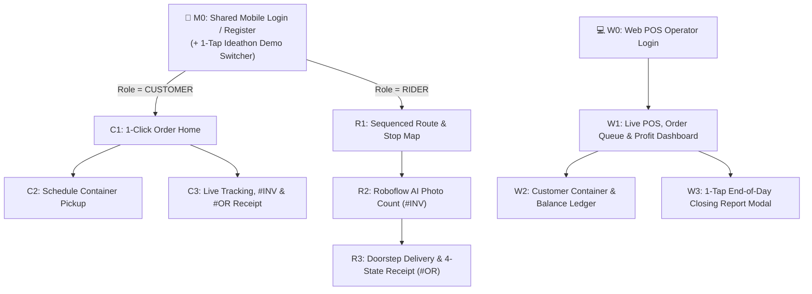

# 11 - Application & Web POS UI Wireframing

## Overview
This document defines the screen-by-screen UI wireframes and navigation flows for the **LG Nature's Water** platform across both applications:
1. **Mobile Application (`mobile/` — React Native Expo):**
   * **Shared Auth & Onboarding (`M0`)** with a **1-Tap Ideathon Demo Role Switcher**.
   * **Role 1: Customer View (`CUSTOMER`)** — 1-Click Ordering, Container Pickup Scheduling, and Live `#INV` $\rightarrow$ `#OR` Tracking.
   * **Role 2: Delivery Team View (`RIDER`)** — Sequenced Turn-by-Turn Route Map, Roboflow AI Photo Container Count (`#INV`), and Doorstep 4-State Smart Receipts (`#OR`).
2. **Station Counter Web POS (`web-pos/` — React + Vite + Tailwind CSS):**
   * **Role 3: Water Refilling Operator View (`OPERATOR`)** — Live POS Register, True Net Profit Tracker (Gross Revenue minus Water/Electricity/Container Wear costs), Customer Container Accountability Ledger, and 1-Tap End-of-Day Closing Report.

---

## Navigation & Screen Flow Diagram



---

## Part 1: Mobile App — Shared Auth & Onboarding (`mobile/`)

### Screen M0: Login & 2-Step Customer Signup
Includes the top **Ideathon Demo Bar** so you can switch between `CUSTOMER`, `RIDER`, and `OPERATOR` in a single tap during the live presentation.

```text
+------------------------------------------+
| [Demo Bar: (Customer) | Rider | Operator]| <-- Ideathon 1-Tap Role Switcher
+------------------------------------------+
|            💧 LG NATURE'S WATER          |
|       One Tap Water Delivery & POS       |
|                                          |
|  Phone Number                            |
|  [ +63 917 000 0003                    ] |
|                                          |
|  Password                                |
|  [ ••••••••••••                        ] |
|                                          |
|  [          LOG IN (ONE TAP)           ] |
|                                          |
|  New Household/Office?                   |
|  [   Set Up 1-Click Delivery Profile   ] |
|    -> Step 2: Pin GPS on Map (Auto-links |
|       Nearest Branch) + Default Gallons  |
+------------------------------------------+
```

---

## Part 2: Mobile App — Role 1: Customer View (`CUSTOMER`)

### Screen C1: 1-Click Order Home & Account Accountability (Feature 03)
Replaces calling the station and repeating customer address and container preferences.

```text
+------------------------------------------+
| 💧 Hi, Maria Santos         [🔔 1] [👤]  |
| 📍 Blk 4 Lot 12 Pansol St, QC            |
| 🏪 Nearest: Station 1 (Main Hub - 0.3km) |
+------------------------------------------+
| ACCOUNTABILITY SUMMARY                   |
| +------------------+-------------------+ |
| | Empty Containers | Unpaid Balance    | |
| |   3 Gallons Out  |   PHP 100.00      | |
| | Due: Oct 22      | (From OR #1038)   | |
| +------------------+-------------------+ |
|                                          |
| ⚡ ONE-CLICK USUAL ORDER                 |
| +--------------------------------------+ |
| | 8x 5-Gallon Slim Refill   PHP 200.00 | |
| | Delivery Fee               PHP 30.00 | |
| | Total                     PHP 230.00 | |
| |                                      | |
| | [   💧 TAP TO ORDER USUAL (8)    ]   | |
| +--------------------------------------+ |
|                                          |
| Need a custom quantity or pickup slot?   |
| [ 📅 Schedule Empty Container Pickup ]   |
+------------------------------------------+
| [🏠 Home]   [📅 Pickup]   [🧾 Receipts]  |
+------------------------------------------+
```

### Screen C2: Schedule & Container Pickup (Feature 02)
Matches **Slide 8** of the pitch deck (*Customer-set schedules + Empty container accountability + Day-before reminders*).

```text
+------------------------------------------+
| ← Schedule a Pickup                      |
+------------------------------------------+
| 1. SELECT PICKUP DAY                     |
| +----------+  +----------+  +----------+ |
| |  MON 12  |  | *TUE 13* |  |  WED 14  | |
| +----------+  +----------+  +----------+ |
|                                          |
| 2. SELECT TIME WINDOW                    |
| ( ) 8:00 – 10:00 AM                      |
| (•) 1:00 – 3:00 PM   [Selected]          |
| ( ) 4:00 – 6:00 PM                       |
|                                          |
| 3. EMPTY CONTAINERS READY FOR PICKUP     |
| (You currently have 3 containers out)    |
|        [ - ]      3      [ + ]           |
|                                          |
| 🔔 Auto-Reminder: We will notify you &   |
|    Station 1 the day before pickup.      |
|                                          |
| [        CONFIRM PICKUP SCHEDULE       ] |
+------------------------------------------+
```

### Screen C3: Live Order Status & "One Count, Two Documents" View (Features 05 & 06)
Shows the customer the pre-dispatch **Invoice (`#INV`)** while the rider is still at the station, then transitions to the **Official Receipt (`#OR`)** upon delivery.

```text
+------------------------------------------+
| ← Active Order #1042                     |
+------------------------------------------+
| [✓ Photo Taken] -> [• Out for Delivery]  |
|                    -> [ ] Receipt Issued |
|                                          |
| 🛵 Rider J. Cruz is 2 stops away (4 min) |
| +--------------------------------------+ |
| |       [ Live Mini-Map Preview ]      | |
| +--------------------------------------+ |
|                                          |
| 📄 INVOICE #INV-1042 (Before Dispatch)   |
| Issued 9:42 AM • Verified by AI Photo    |
| ---------------------------------------- |
| [Photo Thumbnail: 8 Containers Boxed]    |
| 8 containers refilled         PHP 200.00 |
| Delivery fee                   PHP 30.00 |
| ---------------------------------------- |
| AMOUNT DUE                    PHP 230.00 |
| Status: [ AWAITING DELIVERY ]            |
| *(Converts to Official Receipt #OR-1042  |
|   automatically upon doorstep confirmation)*
+------------------------------------------+
```

---

## Part 3: Mobile App — Role 2: Delivery Team / Rider View (`RIDER`)

### Screen R1: Smart Sequenced Route & Stop Manifest (Feature 01)
Matches **Slide 7** (*Nearest-station logic + Turn-by-turn sequenced stops grouping deliveries and pickups on the same street*).

```text
+------------------------------------------+
| 🛵 Rider: J. Cruz       Branch: Station 1|
| Trip #T-204 • 3 Sequenced Stops (Pansol) |
+------------------------------------------+
| +--------------------------------------+ |
| |           🗺️ INTERACTIVE MAP         | |
| |    [🏪 Stn 1] ===> (1) ===> (2) =>(3)| |
| |    Fuel Saved: ~28% | Same-Street    | |
| +--------------------------------------+ |
|                                          |
| SEQUENCED STOPS (Auto-Ordered)           |
| +--------------------------------------+ |
| | (1) Maria Santos • Blk 4 Lot 12      | |
| |     💧 Deliver: 8  | ♻️ Pickup: 3    | |
| |     Slot: 1–3 PM   | Status: #INV    | |
| |     [📷 AI Count]  [✅ Deliver #OR]  | |
| +--------------------------------------+ |
| | (2) Carlo Mendoza • 18 Xavierville   | |
| |     💧 Deliver: 6  | ♻️ Pickup: 6    | |
| +--------------------------------------+ |
+------------------------------------------+
| [🗺️ Route]   [📷 AI Count]   [🖨️ Printer]|
+------------------------------------------+
```

### Screen R2: AI Photo Container Count & Instant Billing (Feature 04)
Matches **Slide 10** (*Roboflow `gallon-quality-detection` bounding boxes `1..8` + Auto-Generated Bill*).

```text
+------------------------------------------+
| ← AI Photo Container Count (Order #1042) |
+------------------------------------------+
| +--------------------------------------+ |
| |   📷 CAMERA / CAPTURED LOAD PHOTO    | |
| |   +---+ +---+ +---+ +---+            | |
| |   |[1]| |[2]| |[3]| |[4]|            | |
| |   +---+ +---+ +---+ +---+            | |
| |   +---+ +---+ +---+ +---+            | |
| |   |[5]| |[6]| |[7]| |[8]|            | |
| |   +---+ +---+ +---+ +---+            | |
| |  [🟢 8 containers detected • 96% AI] | |
| +--------------------------------------+ |
|                                          |
| AUTO-GENERATED BILL (Pre-Dispatch #INV)  |
| 8 containers refilled (x25)   PHP 200.00 |
| Delivery fee                   PHP 30.00 |
| TOTAL DUE                     PHP 230.00 |
|                                          |
| [🔄 Retake]  [⚡ ISSUE INVOICE #INV-1042]|
+------------------------------------------+
```

### Screen R3: Doorstep Proof of Delivery & 4-State Smart Receipt (Features 05 & 06)
Matches **Slides 11 & 12** (*Converts `#INV-1042` to `#OR-1042` with zero re-encoding, adapts to `PAID`, `E-PAYMENT`, `PARTIAL`, or `UNPAID`*).

```text
+------------------------------------------+
| ← Confirm Delivery • #INV-1042 -> #OR    |
+------------------------------------------+
| Verified Count: 8 Refills (Locked by AI) |
| Empty Containers Collected: [-] 3 [+]    |
| Total Due: PHP 230.00                    |
|                                          |
| SELECT PAYMENT STATE AT DOORSTEP:        |
| [💵 PAID] [📱 E-PAY] [*🌗 PARTIAL*] [📝 UNPAID]
|                                          |
| Amount Paid Now: [ PHP 130.00          ] |
| Balance Carried:   PHP 100.00 (Auto)     |
|                                          |
| LIVE SMART RECEIPT PREVIEW (#OR-1042):   |
| +--------------------------------------+ |
| |         LG NATURE'S WATER            | |
| |       OFFICIAL RECEIPT #OR-1042      | |
| | Aug 20, 2026 • Rider: J. Cruz        | |
| | 8 containers refilled      PHP 200.00| |
| | Delivery fee                PHP 30.00| |
| | TOTAL                      PHP 230.00| |
| | Amount Paid                PHP 130.00| |
| | Balance Due                PHP 100.00| |
| |        *** PARTIALLY PAID ***        | |
| +--------------------------------------+ |
| [🖨️ Print Bluetooth 58mm] [📤 Send OR]   |
+------------------------------------------+
```

---

## Part 4: Station Counter Web POS (`web-pos/` — Role 3: `OPERATOR`)

### Screen W1: Operator POS & Live True Profit Dashboard (Feature 03)
Matches **Slide 9** (*Replaces the notebook; computes Gross Revenue, Cost of Refill, and True Net Profit live*).

```text
+-----------------------------------------------------------------------------------+
| 💧 LG NATURE'S WATER — STATION 1 POS        [➕ Walk-In Order] [📊 1-Tap EOD Report]|
+-----------------------------------------------------------------------------------+
| LIVE PROFIT TRACKER (Today's Shift)                                               |
| +-------------------+ +---------------------+ +------------------+ +------------+ |
| | 💰 Gross Revenue  | | ⚙️ Cost of Refill   | | 📈 True Net Profit| | ♻️ Jugs Out| |
| |   PHP 9,010.00    | |  - PHP 2,480.00     | |   PHP 6,530.00   | | 48 Gallons | |
| | (42 Orders Today) | | (Water+Elec+Wear)   | | (+40% Efficiency)| | (6 Overdue)| |
| +-------------------+ +---------------------+ +------------------+ +------------+ |
|                                                                                   |
| LIVE ORDER & DISPATCH QUEUE                     | QUICK COUNTER REGISTER          |
| +---------------------------------------------+ | +-----------------------------+ |
| | #1042 | Maria Santos | 8 Jugs | 1–3 PM      | | | Customer: [Search / Walk-in]| |
| | Doc: #OR-1042 (PARTIAL • Bal: PHP 100)      | | | Preset: 5-Gal Slim (PHP 25) | |
| |---------------------------------------------| | | Qty: [ 8 ]  Fee: PHP 30.00  | |
| | #1043 | Carlo Mendoza| 6 Jugs | 4–6 PM      | | | Total: PHP 230.00           | |
| | Doc: #INV-1043 (8 Boxed by AI • Dispatched) | | | Cash Tendered: [PHP 250.00] | |
| |---------------------------------------------| | | Exact Change:   PHP 20.00   | |
| | [🗺️ Auto-Sequence Rider Route (3 Stops)]    | | | [  ⚡ LOG & PRINT RECEIPT  ] | |
| +---------------------------------------------+ +-----------------------------+ |
+-----------------------------------------------------------------------------------+
```

### Screen W2: Customer Container & Unpaid Balance Ledger
```text
+-----------------------------------------------------------------------------------+
| 🔍 Search Customer: [ Maria Santos...            ]   [🔔 Send Day-Before Reminders]|
+-----------------------------------------------------------------------------------+
| CUSTOMER              | ADDRESS              | JUGS OUT | DUE DATE | UNPAID BAL   |
|-----------------------|----------------------|----------|----------|--------------|
| Maria Santos          | Blk 4 Lot 12 Pansol  | 5 Jugs   | Oct 22   | PHP 100.00   |
| Carlo Mendoza         | 18 Xavierville Ave   | 0 Jugs   | —        | PHP 0.00     |
| ABC Office Hub        | 102 Katipunan Ave    | 12 Jugs  | OVERDUE  | PHP 460.00   |
+-----------------------------------------------------------------------------------+
```

### Screen W3: 1-Tap End-of-Day Closing Report Modal
```text
+------------------------------------------------------------+
| 📊 END-OF-DAY CLOSING REPORT — AUG 20, 2026                |
| Branch: LG Nature's Water — Station 1 (Main Hub)           |
+------------------------------------------------------------+
| OPERATIONS SUMMARY                                         |
| • Total Orders Completed:             42 Orders            |
| • Total Containers Refilled:          310 Containers       |
| • Total Empty Containers Collected:   295 Containers       |
|                                                            |
| FINANCIAL & TRUE PROFIT BREAKDOWN                          |
| • Gross Sales Revenue:                      PHP 9,010.00   |
|   - Cash Collected:          PHP 6,450.00                  |
|   - GCash / Maya E-Payment:  PHP 1,860.00                  |
|   - Unpaid / Partial Added:  PHP   700.00                  |
| • Less: Cost of Refill                                     |
|   - Water Cost (PHP 3/jug):                -PHP   930.00   |
|   - Electricity Cost (PHP 3/jug):          -PHP   930.00   |
|   - Container Wear (PHP 2/jug):            -PHP   620.00   |
| ---------------------------------------------------------- |
| 🏆 TRUE NET PROFIT TODAY:                   PHP 6,530.00   |
|                                                            |
| [🖨️ Print Thermal Summary]      [📥 Export PDF Report]     |
+------------------------------------------------------------+
```
